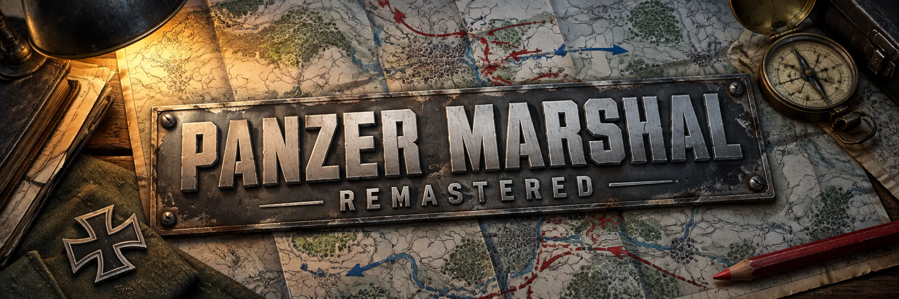
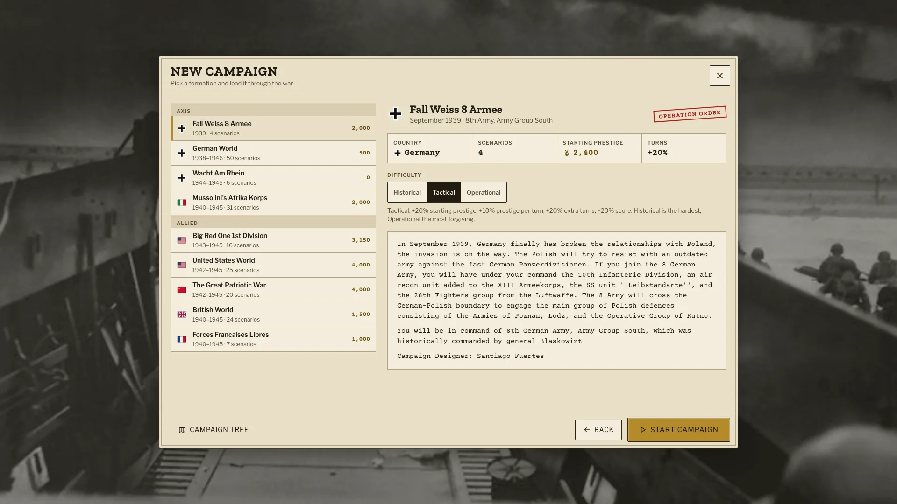
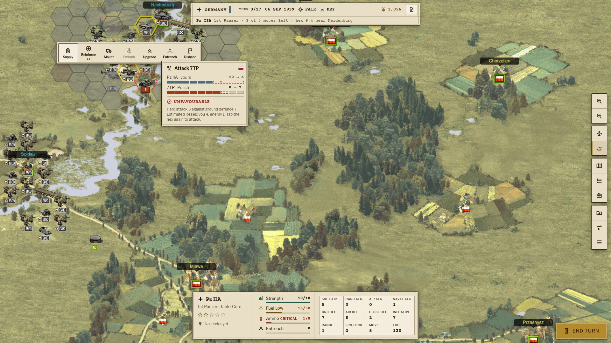
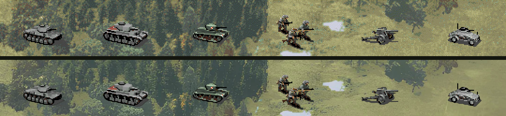
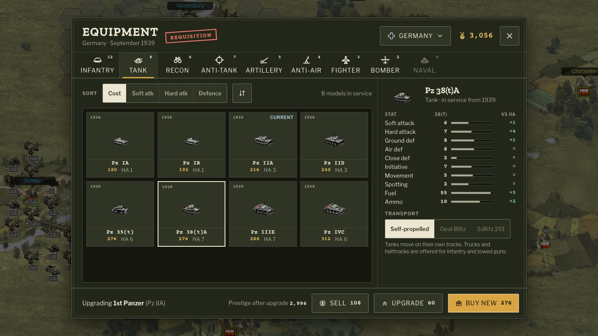

# Panzer Marshal Remastered

Panzer General 2, in the browser, made better without being made different.

Nicu Pavel rebuilt it for the browser as [OpenPanzer](https://github.com/nicupavel/openpanzer)
and then [Panzer Marshal](https://github.com/nicupavel/panzermarshal). This project takes
Panzer Marshal 3.2.14, its last version, and carries it forward.

## What we're doing

**Keep the spirit.** Core units you care about, scenarios that play like puzzles against the turn
limit, the joy of an overrun and the dread of a rugged defense, quick turns, rules you learn in
an hour. We don't add complexity for its own sake. [docs/RESEARCH.md](docs/RESEARCH.md) is why.

*Design mockup. All 17 campaigns of Panzer Marshal stay, picked from a list grouped by side,
with the starting prestige and what each difficulty changes in plain words.*

**Make it readable.** PG2 made you do the combat maths in your head. The remaster shows you the
odds before you attack and tells you why a battle went the way it did.

*Design mockup. Before attacking the 7TP the Pz IIA sees it would lose 4 strength for 1: hard
attack 3 against ground defence 7. Low fuel and ammo say so in words, not only in colour.*

**Make good on the old promises first.** Rain and snow that do nothing, leader abilities with
no effect, an AI that never defends its own flags: the manual promises things the game doesn't
do. Those come before anything new ([docs/MECHANICS.md](docs/MECHANICS.md)).

**Then fix what players always wished for**, carefully: supply lines and encirclement, units
that fight better together, a campaign that doesn't snowball or spiral. Each one is a design
discussion in the [issues](https://github.com/szymdzum/openpanzer-remastered/issues) first.

**Make it look good on today's screens.** Sharp on HiDPI, upscaled maps and units, a period
look and a soundtrack, without losing the painted-map feel.

*The first test, on a HiDPI screen: today's pixels above, the remaster below. The map went
through Real-ESRGAN, the hand-drawn sprites through hqx, a pixel-art filter that keeps their
edges.*

The interface becomes a 1940s war room, paper, typed orders and brass, in a light theme and a
dark one for long evenings, and gets out of the map's way.

*Design mockup. Upgrading the 1st Panzer: every stat of the new tank next to the old one,
and the prestige left after paying.*

**Change nothing by accident.** The game was first reconstructed from its minified build, bug
for bug. Every build of the remaster is replayed against that reconstruction, step by step:
a refactor must change nothing, and a deliberate change shows exactly what it changed.

Where we are: the code is typed, modular TypeScript on Vite. Next are the quick visible wins:
sharp HiDPI canvases, the attack preview, the move path. The whole plan is in
[ROADMAP.md](ROADMAP.md).

## Play and develop

    npm install
    npm run dev          # http://127.0.0.1:8644/, reloads on every change in src/
    npm run check        # types (tsc): noImplicitAny and the strict flags except strictNullChecks
    npm run lint         # oxlint, type-aware (.oxlintrc.json)
    npm run gate         # what CI runs: types, lint, fallow, tests with coverage
    npm run fallow       # what a change adds against main: unused code, cycles, duplicates, complexity
    npm run build        # dist/: the bundled game with its assets; npm run preview serves it

- `src/` the game as TypeScript ES modules, `src/main.ts` is the entry
- `game/` the 3.2.14 build with all the assets (the page has `<base href="/game/">`), images,
  sounds and manuals in Git LFS (`git lfs install` before cloning)
- `harness/` the comparison with the reference, `docs/TYPES.md` the typing rules,
  `docs/MECHANICS.md` how the game plays (rules, combat, AI), `docs/RESEARCH.md` what PG2 and
  other WW2 strategy games teach about design, `docs/design/` the current UI

Vite blanks the types out with ts-blank-space instead of compiling: the browser runs src/ line
for line and column for column (only the import paths change), so coverage and stack traces
point at the source.

## Verification

Every change is compared with a reference in headless Chrome, step by step: game state, DOM and
canvas pixels. The reference is the original game (`reference/`: the 3.2.14 source
reconstructed from its bundle, on the same assets, served on 8643), or with `BASELINE_REF=<git
ref>` this repo at that commit on its own Vite. The remaster runs on the Vite dev server (8644);
the scripts start the servers when they're not running.

    npm run verify               # both below, about 3 minutes
    harness/replay.sh            # 16 scenarios, campaigns and the tutorial played AI vs AI
    harness/ui-replay.sh         # 24 scripts of user steps (harness/ui/), or some of them
    BASELINE_REF=origin/main npm run verify   # against main: what a pull request changes

Pull requests run verify on GitHub Actions against their base branch (`.github/workflows/
verify.yml`): main differs from the original on purpose (the unit markers), so against main a
refactor comes out identical and a deliberate change shows only itself.

Every item and script plays in its own Chrome, several at once (JOBS, default 3/4 of the
cores). The reference's traces are cached per item in harness/out/baseline, until the reference
or the harness changes. A step that waits for loads until the timeout is reported: it usually
means a stuck request.

A refactor must leave both identical. A deliberate change shows exactly what it changed.

The contract tests check the engine in seconds, without a browser: Vitest restores 13 game
states recorded on the reference and replays the reference's calls on them.

    npm test                     # 3 contracts on 15 states and the engine tests, about 9 seconds
    npm run test:coverage        # the same, with what they run of the engine (coverage/)
    npm run record <module>      # record a contract again on the reference

- `gamerules`: every rule (movement, combat, supply, experience) on every unit and unit pair
- `unit`: every Unit method on a copy of every unit
- `engine`: the AI plays every player for 2 turns through Map, Unit, GameRules, Leaders and
  Scenario, with random player actions of every kind mixed in (embarking and undo included),
  a hash of the whole state after each step; then the campaign functions, the saved game, the
  combat log and the equipment data

A bug fixed on purpose changes a contract, and the reference still has the bug: `UPDATE_CONTRACTS=1
npm test` writes the remaster's results into the fixtures (the recorded states stay). Do it only in
the commit that fixes the issue, and say in it what changed; a refactor never re-records.

GitHub Actions runs the types, the linter, fallow, typos and the tests with coverage on every pull request
and on main (`.github/workflows/ci.yml`); main takes changes only through a pull request with that
check green. Each engine file has a coverage floor (`thresholds` in `vite.config.mts`): a change may
raise it, not lower it.
Mutation testing checks the tests themselves: Stryker changes the engine one small thing at a
time and expects a contract to fail every time. It takes hours for the whole engine, so CI runs
it every Sunday and on demand, one runner per module, the reports as the run's artifacts
(`mutation.yml`). Locally, one module at a time: `MUTATE=map npm run test:mutation`.

## Credits

Panzer General 2 by SSI. OpenPanzer and Panzer Marshal, code and assets, by Nicu Pavel and
contributors. The remaster builds on their work.
