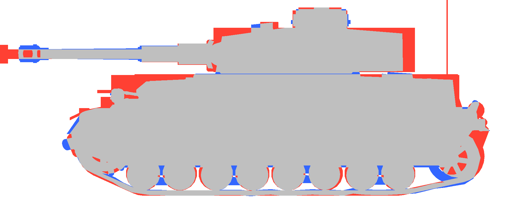
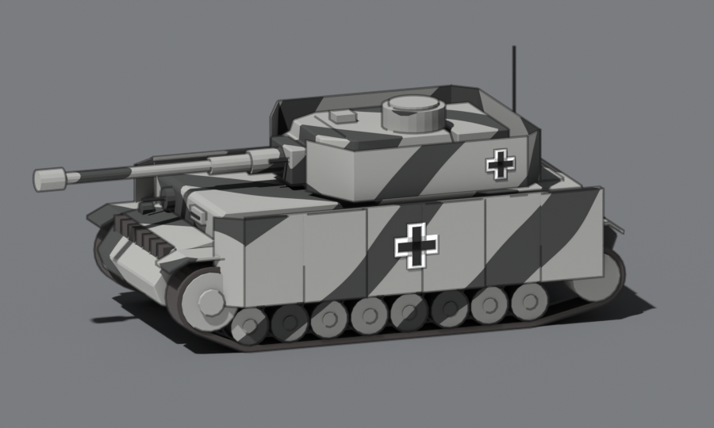
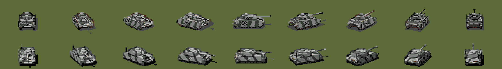
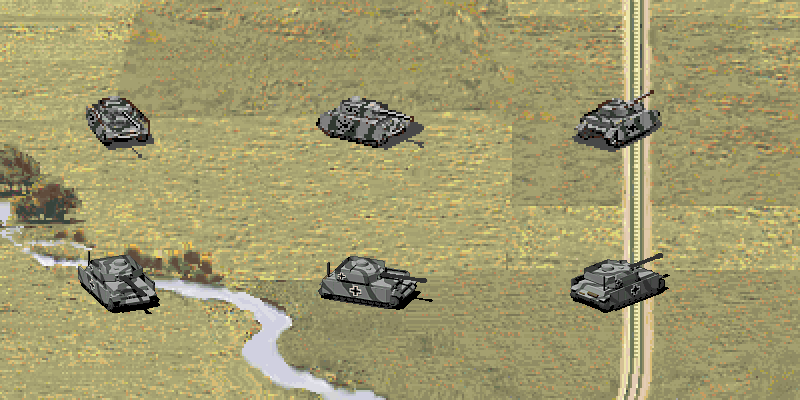
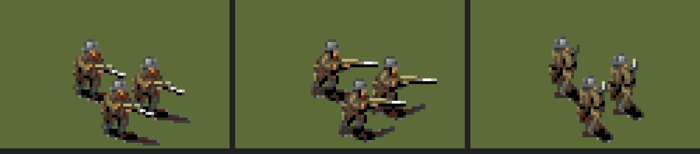
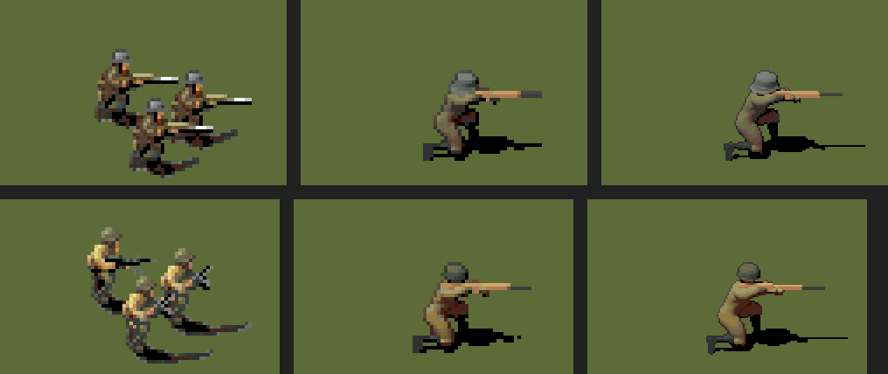
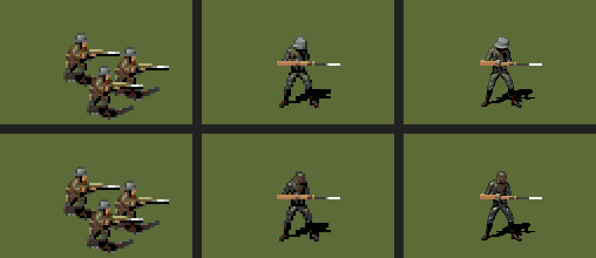
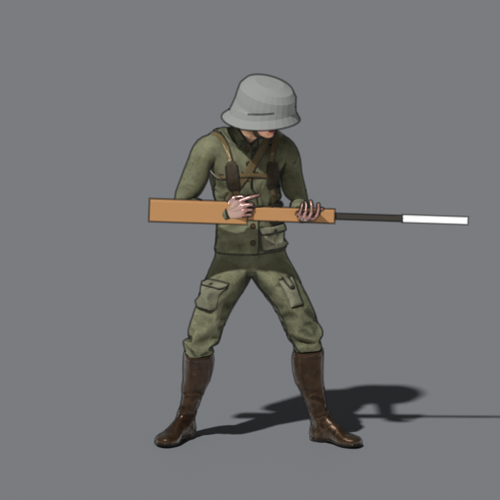

# New unit and map graphics: research

How the unit sprites and the maps could get a new look: 3D models rendered as sprites, the maps
still hand painted. Nothing is built yet; this is the base for a pilot. Research from October
2026. The licences come partly from third-party blogs: check each one on the model's own page or
in the repository's LICENSE before using it.

## What we have

- Units: 3476 sprite sheets in `game/resources/units/images/`, 720×50 px each: 9 facings of 80 px
  in one strip. The other 7 facings are the same frames mirrored (`src/view/map/mapdraw.ts`; the old
  renderer's `drawUnitSprite` until #351). The old renderer drew `@2x` images at half their pixel
  size (`imgScale`), so sharper sprites dropped in without engine changes; the UI doesn't load them
  yet (#462). Many sheets are variants of
  the same vehicle (countries, paint).
- Maps: 239 hand-painted images of 1920×1920 in `game/resources/maps/images/`, 247 MB. Each one
  has to line up exactly with its scenario's hex grid.
- New graphics change no game logic, but verify shows the canvas pixels differ, on purpose, as it
  already does for the unit markers.

## How PG2 made its graphics

The PG2 units were not 3D renders. SSI built and painted scale models, set them on a lazy Susan
in front of a blue screen and photographed them from several angles. The maps were painted by
hand from pencil schematics drawn by the scenario writers ([GameSpot preview][gs]).

So the style to aim for is a 3D render that looks like a painted miniature: matte light, a
contact shadow, a light outline. That stays true to the original rather than "going 3D".

## Units

### Rendering: Blender and our own script

There are paid Blender add-ons that turn a model into a sprite sheet: [Pre Render Creator][prc],
[Auto Spritesheet Pro][asp], [8 Directions Render Plugin][8d], [Sprite Render Kit][srk] (old
Blender). We don't need them. Our format is simple (9 facings in a strip, the rest mirrored), and
a `bpy` script run headless (`blender -b -P render_unit.py`) does it the same way every time:

- an orthographic camera at the PG2 angle, the model turned through the 9 facings;
- a fixed sun, a contact shadow, an outline (Freestyle or Line Art);
- rendered at `@2x` (160×100 per frame), packed into the strip;
- checked against the old sprite: size, anchor point, facing order.

[blender-mcp][bmcp] lets Claude drive a live Blender (it sees the viewport and can search
Sketchfab and Poly Haven), which is handy for trying things out. For production a script is
better: the output is deterministic.

At 80×50 px the model's detail hardly shows. What counts is the silhouette, the proportions and
the camouflage: a low-poly model with a good texture is enough.

### Where the models come from

Most free WW2 models are toy-like or stylized. Three sources are worth it, each of a different
kind.

**1. Spring: 1944 (the base).** A free WW2 RTS kept up by its community for years
([GitHub][s44]). Its `objects3d/` holds about 750 textured models by nation: Germany, the Soviet
Union, the US and Britain, but also Italy, Japan, Hungary, France and Sweden, close to the PG2
roster. The German folder alone has the Jagdpanther, Jagdpanzer IV, Bf 109, Fw 190, Ju 87G,
Kübelwagen, MG42 and FlaK guns. They are RTS models, seen from above, with a sensible polygon
count and historical paint: what an 80×50 sprite needs. The models are mostly `.s3o` (the Spring
engine's format), some already `.dae`; Blender needs an importer, which the Spring community has.

Licence: `docs/License.txt` puts the models and textures under CC-BY-NC 3.0 (the Lua code is
GPL): free to use with credit, non-commercial only. Fine while the game stays free; it rules out
selling it (Steam, say). The repo has no LICENSE yet: the Spring: 1944 graphics would get their
own licence and credits, apart from the code.

**2. Wargaming miniatures for 3D printing (15 mm, 28 mm).** The most accurate WW2 models today
come from the designers of Flames of War and Bolt Action miniatures, close in spirit to SSI's
photographed scale models. [Wargame3D][w3d] has hundreds of vehicles of every nation
([list by nation][w3dl]): about 7 € a model for personal use, about 22 € with a commercial
licence. Also [WW2 3D Models on Thangs][thangs] (a Tiger for 5 $), packs on
[MyMiniFactory][mmf], single free models on [MakerWorld][mw] and Printables. The STL files have
no textures, so we paint the camouflage and markings in Blender. Their licences speak of
printing: rendering them for a game has to be agreed with the author (Wargame3D gives an email).

**3. Paid game models (CGTrader, TurboSquid).** A royalty-free licence allows a model in a game,
and we only ship rendered images, the simplest case. A realistic tank is usually 10-60 $. For
the gaps.

The plan: Spring: 1944 as the base, the gaps filled with wargaming models we paint, or single
bought ones. If the game should stay sellable, the base is the wargaming models with a commercial
licence instead.

Also useful: [Mixamo][mixamo] for infantry poses (free for games). The free low-poly models that
turned up first are mostly stylized: the Sketchfab Shermans ([M4 early][m4e], [M4A3 (76)
HVSS][m4a3], [M4A1 (76)][m4a1], CC-BY, untextured), the [Lowpoly Tank Pack][ltp] and the CC0
[Low Poly Battle Pack][lpbp] on itch.io, a [King Tiger][kt] on BlendSwap, [OpenGameArt][oga1]
tanks.

To avoid: models ripped from World of Tanks, War Thunder and other games (copyright), files
licensed "for 3D printing" or personal display only, and the models of the
[PG2 mod for Panzer Corps 2][pc2mod], whose author forbids reuse.

### AI image-to-3D

- **TRELLIS.2** (Microsoft): ranked the best open-source model, MIT. There is an Apple Silicon
  port ([trellis-mac][tmac]): about 24 GB of unified memory, a few minutes per model. Good for a
  first draft from a reference (a photo or drawing of the tank); the mesh needs cleaning up.
- **Hunyuan3D** (Tencent): the best textures, but its community licence excludes the EU, the UK
  and South Korea ([LICENSE][hlic]). Not usable from Poland.
- **Tripo / Meshy**: convenient, hosted. Tripo's free tier is non-commercial; Meshy's free tier
  reportedly requires CC-BY (unconfirmed) ([comparison][cmp1], [another][cmp2]).

AI gives a draft, not a finished model. At this scale kitbashing pays off more: one hull,
swapped turrets, guns and paint for the variants.

### The scale of the job

Thousands of sheets can't be done by hand. A realistic plan:

1. Archetypes from the campaigns, about 30-50 models: the most common German, Soviet and US
   units first.
2. Variants from the same script: the country's texture, camouflage, a different gun.
3. The rest keeps its old graphic. In the matte miniature style old and new should sit together
   reasonably well.
4. Infantry is the hardest: a group of 3-4 figures in Mixamo poses, slightly varied.

## Maps

**A. Upscale 2× (the place to start).** The geometry stays, so the hexes stay where they are. The
Infinity Engine (Baldur's Gate) community tried this on similar painted backgrounds: ESRGAN did
far better than Waifu2x ([Beamdog thread][bd1]), and REAL-ESRGAN gave results players praised
([second thread][bd2]). Their trouble was seams from cutting the backgrounds into tiles; our maps
are one image each. Real-ESRGAN has an ncnn-vulkan build that runs on a Mac. The main risk is the
"plastic" look (too smooth, too saturated): slight desaturation and reinjected fine noise or
high-pass detail help ([Tripo blog][tripo]).

**B. img2img with ControlNet Tile at low strength.** More painterly detail than a plain upscale,
but it can move rivers and roads off their hexes. We'd need a check: lay the grid over the map
and compare what's under each hex with the scenario's terrain. No tested workflow for hex maps
turned up ([ControlNet Tile][cnt]).

**C. Maps generated from the terrain data, with a LoRA trained on the existing maps.**
[Scenario][scn] suggests 8-20 consistent samples, transitions between terrains included. The
biggest project of the three; worth it only for new scenarios.

Practical points:

- Size: 2× is about 1 GB. Move to WebP or AVIF and load only the maps a scenario needs.
- Rights: the maps and sprites are SSI/Ubisoft art inherited through Panzer Marshal. An upscale
  is still derived from that art. New renders of our own or CC models are cleaner.

## Pilot: the Panzer IV H (October 2026)

The first unit made from scratch: the Pz IV H, whose old strip is
`game/resources/units/images/pa131.png`. The scripts are in `art/units/`, the pictures below in
`docs/assets-pilot/`.

### How it was made

- **The model is a script, not modelling by hand** (`art/units/panzer_iv.py`): boxes, prisms and
  cylinders placed by real measurements. The first try, built from the overall dimensions only
  (length, width, height), looked like a box, not a Panzer IV: the proportions inside the outline
  are what make the vehicle.
- **The measurements come from a drawing.** `File:Panzer_IV_G.svg` on Wikimedia Commons (public
  domain, `art/units/reference/`) scaled to the real 5.89 m hull, 269 px a metre; the heights,
  the sprocket, the idler, the eight road wheels in four bogies, the four return rollers and the
  three steps of the gun were read off its outline. What the G lacks came from photographs of the
  H (Bundesarchiv Bild 101I-298-1759-25, the Thun and El Goloso museum tanks): the six hull
  Schürzen on their rail, the turret Schürzen open in front and wrapped round the stowage bin,
  the longer L/48 gun with its muzzle brake, spare track links on the nose.
- **The model is checked against the drawing**: `render.py side` renders the side at the
  drawing's scale and lays it over it. The outlines overlap 90%; what differs is the H's skirts
  and gun.

- **The camera matches the old sprites**: `render.py fit` renders the outline at a range of
  camera angles and scales and compares it with the old strip's. Best: orthographic, 22.5 degrees
  above the ground. Frame i faces S turned i × 22.5 degrees towards E.

### What a smooth render taught us

A plain render, anti-aliased and softly lit, does not look better than the old sprite: it blends
into the painted map, and the old one has a charm of its own (hard pixels, strong contrast, a
dark rim, a black shadow). Real 1944 colours (Dunkelgelb with green and brown stripes) make it
worse: yellow on the yellow-brown maps, and a fine camouflage turns to noise at 80×50.

So the sprite is made the PG2 way (`render.py pixel`): rendered 8 times larger, then cut down to
the sprite's pixels without smoothing, every pixel set to the nearest colour of the **old strip's
own palette**, the edge of the silhouette darkened, the shadow solid black. The camouflage is the
old one too: Panzergrau with broad dark bands. It gives the 1x strip (80×50 a frame) and the @2x
one.

### The old sprites are squatter than the real tank

With true proportions the new tank came out narrower and taller than the old one. Measured
outlines without the shadow, 1x pixels:

| Frame | Old | True scale (7.2 px/m) | First fix (7.6 px/m, height × 0.9) | Final (7.6 px/m, height × 0.85) |
|---|---|---|---|---|
| 0, front | 28 × 28 | 24 × 26 | 26 × 26 | 26 × 29 |
| 2, three-quarter | 43 × 27 | 44 × 28 | 46 × 28 | 46 × 28 |
| 4, side | 56 × 23 | 51 × 24 | 54 × 23 | 54 × 22 |
| 8, rear | 25 × 25 | 24 × 31 | 26 × 31 | 26 × 31 |

The old strip is not one consistent projection: 56 px long from the side but 43 px across at 45
degrees, where a true projection of that length and width would be about 59. The photographs of
the scale models were probably taken close up, with perspective, so each angle is squeezed
differently. A geometric render can't match every frame; the chosen scale keeps the new tank the
size of the old units on the map: front and side 1-2 px smaller, the diagonals 1-3 px larger, the
area of every frame within 5% of the old one. The rear view stays taller (the gun shows above the
turret from behind). The front grew 3 px with the thicker antenna.

The model keeps its real measurements: only the projection is scaled (`render.py pixel`:
`pxm`, `squash`), as SSI's camera did.

### Sitting on the ground

Even at the old size the new tank looked taller, "not sitting on the ground" like the old one.
Two measurable reasons:

- **Where the mass is.** From the side the old sprite is widest at 70% of its height, down at the
  long hull and the tracks; the first renders were widest at 26%, up at the turret skirts and the
  gun. A tank that is heaviest at the bottom reads as standing on the ground. The stronger squash
  (0.85) and the darker running gear move the weight down.
- **Where it stands in the frame.** The new tracks ended 2 px lower than the old ones (y 43-46
  against 41-44 in the 80×50 frame), so on a hex it stood differently from every other unit. The
  camera now puts the vehicle's middle 2 px higher (`CENTRE`), and the tracks end where the old
  strips' do.

### Fixes for the sprite

- The gun and the antenna are drawn thicker than real in the pixel strips (`THICKEN` in
  `panzer_iv.py`: the gun 1.6 times, the antenna 5 times): at real size the gun is thinner than a
  pixel and breaks up, the old strips draw both as a clear line.
- A higher sun (25 degrees from straight down): a bright roof over darker sides, as on the old
  sprites. The road wheels, sprocket, idler and return rollers are a dark grey of their own, in
  the shade under the skirts.
- The camouflage bands are more irregular (more distortion in the wave).

### Seen in the game

The old renderer loaded a sharper file for each unit on high density screens (`hdPath`, src/render.ts
until #351): `resources/units/images/pa131.png` was drawn from `/hd/units/images/pa131.webp` when it
existed. The UI doesn't load these files yet (#462); once it does, the new strip goes in without touching
the game:

    cwebp -lossless out@2x.png -o public/hd/units/images/pa131.webp

`npm run dev`, then on a screen of 1.5x or more: New Game, Scenarios, **Zitadelle** (not
"Operation Zitadelle"): six Pz IVH stand in the German column on the road to Belgorod, on hexes
(20,6), (20,12), (21,15), (25,23), (28,23), (28,33). Hovering one shows "Unit: Pz IVH". It works:
the tank shows, selects and moves like any other unit. `public/hd/` is not in Git (it holds the
generated files of `scripts/upscale-assets.sh`), so the strip only shows where it was copied.

### A second review

An independent review of the strip (Claude, read-only) asked for five things. Done in the scripts:

- **The brick silhouette**: on top of the height squash, the pixel strip widens the tank 8%
  (`widen` in `render.py pixel`): the front is 28 × 29 px against the old 28 × 28. The diagonals
  grow with it (8-19% more area than the old frames): the old strip's inconsistent proportions
  again.
- **The gun breaking up**: a third render pass shows the gun alone, the rest of the tank held out
  (so the turret still hides it from behind), and every pixel it touches is drawn in a dark
  colour of the palette: an unbroken line in every frame.
- **A calmer camouflage**: a darker base, lighter bands, narrower. It came out too calm: the bands
  nearly vanish, the old ones show clearly, only darker. The next setting is halfway.
- **Bigger crosses** on the hull skirts (1.5 times): a readable black and white spot at 1x.
- Not done: "the turret is too high, the muzzle brake sticks out of the drawing". That is the H's
  turret skirts and its longer L/48 gun, which the G of the drawing doesn't have.

### What's left

- The camouflage halfway between the two settings above.
- A way to ship the new strips: `public/hd/` is generated and ignored, so a made strip needs its
  own place in the repo and a step that copies it there (after `upscale-assets.sh`, which skips
  files that exist).
- The widths (turret, superstructure) come from photographs and general data, not a top view;
  *Panzer Tracts 4-3* has one.
- The camouflage is the old grey; Dunkelgelb (`PALETTE=dunkelgelb`) blends into the yellow maps.

### Cost

Blender is free (GPL; what it renders is ours). One pixel strip takes about 4 minutes on the
laptop's GPU (Cycles, Metal), the drawing check seconds. Writing the model took most of the time:
research first (drawing, photographs, the variant's features), then the script, then the check
against the drawing. The helpers (`box`, `side_prism`, `plan_prism`, the track, the skirts, the
markings) carry over to the next vehicles.

`art/units/render.py scene` saves a `.blend` with the model, the game's camera and the light, to
look round in the Blender app (numpad 0 looks through the game's camera).

## Pilot: infantry (October 2026), parked

The second pilot: the German Infanterie (`jk467`) and the Soviet 43 Strelkovy (`le126`), one
figure, the side frame only. **Conclusion: the tanks are promising, the infantry so-so.** It is
parked; what was learnt is below, the scripts are in `art/units/` (`soldier.py`,
`mixamo_soldier.py`).

### The old infantry

Three figures in a triangle, about 23-30 px tall each at 1x: drawn at about 21 px a metre, nearly
three times the tanks' scale. They are not kneeling: they advance, leaning into a stride, the
weapon held low and level in front, the German rifles with a bright bayonet tip (a bayonet
charge); the Soviets carry PPSh submachine guns. Their colours are dark and warm (brightness 0.2-0.5), the
helmets grey (German) or olive (Soviet). Some strips are not 80×50: `jk467` is 82×53 a frame.

### First try: a built figure (MPFB 2)

[MPFB 2](https://static.makehumancommunity.org/mpfb/faq/use_in_closed_source.html) (MakeHuman
in Blender, CC0 base mesh, an automatic rig) gives the body; `soldier.py` poses it by script
(where the hands, knees and feet go, the bones turned to reach them) and adds a helmet
(Stahlhelm, SSh-40 as surfaces of revolution) and a rifle. Two rounds of independent review
fixed the helmet (it read as a pith helmet: a 45-degree brim the same all round) and the pose
(the rifle at the chest, the head nodding, the left hand short of the rifle). The figure ended up
stocky, in the old strips' colours, the Stahlhelm told from the SSh-40 at 1x.

It still looked wrong: the hands are lumps (the fingers stay spread), the body a bare mannequin,
the boots blocks. A pose made by numbers has nothing to be checked against, unlike the tank,
which was measured on a scale drawing; each review round only moved the numbers.

### Second try: a Mixamo character and motion capture

A Mixamo character in WW2 uniform (Ch49: tunic, webbing, boots, natural hands) in Mixamo
animations recorded on a person, through `mixamo_soldier.py`: the pose taken whole, our rifle put
through the two hands, a bayonet, the figure re-centred on its hips. Mixamo's terms allow the
characters and animations in games but not sharing the raw files, so the FBX files stay out of
Git (`art/units/mixamo/`, downloaded by hand).

- **Rifle Aiming Idle** (aiming standing): a natural pose, but standing and aiming, not the
  charge.
- **Rifle Run** holds the rifle across the chest, muzzle up. Gluing its legs to the aiming arms
  (bone by bone, the upper body turned and levelled) broke the body: the head sank into the
  chest, the rifle went through it. Animations are to be taken whole.
- **Idle** (standing ready, the rifle low and level in front) is the closest to the old figures'
  arms. In it the rifle runs across the body: seen from 22.5 degrees above, a level rifle
  angled away from the camera reads as pointing up, so the figure is turned until the rifle, not
  the body, points the frame's way, and the upper chest bowed a few degrees to level it.
- **Dressing**: the tunic and trousers multiplied to the old strip's field grey (their folds,
  seams and webbing stay), made matt; the M1 helmet pulled in under our Stahlhelm, a lighter grey
  so that it shows at 1x (`NATION=germany`).

### Why parked

At 1x the figure reads as a soldier with a level rifle and a grey helmet, but it does not look
good next to the old ones: it stands square to the camera in a wide, still stance where they
lean into a stride; the rifle is three planks; the Mixamo body is one character for every
nation. Getting it right needs an animation of a charge or a fast walk with the rifle forward
(Mixamo's Pro Rifle Pack may have one), then the Soviet dress (khaki, SSh-40, a PPSh), the three
figures, the nine frames. Cheaper choices for now: keep the old infantry, whose 25-30 px figures
hold up, with the @2x files `scripts/upscale-assets.sh` already makes; spend the 3D pipeline on
rigid things with scale drawings (vehicles, guns: the leFH 18 next).

### Other routes looked at

| Route | Why not (now) |
|---|---|
| CMU motion capture (free) | no kneel-and-aim found, licence unclear (some copies NC), quality uneven |
| Paid mocap packs (e.g. MCO Rifle, about 6 $) | possible; Mixamo covers the same for free |
| Wargame miniatures (STL) | sculpted poses and gear per nation, closest to SSI's photographed models, but one mesh to paint and "personal use" licences |
| AI image to 3D (TRELLIS.2) | needs about 24 GB of memory, the laptop has 16 |
| Pose from a photo (SMPL, HMR) | research-only licences |

## How to make the next unit

The project skill `.claude/skills/making-unit-sprites/` turns this into a step-by-step workflow
with the commands, the gates (`art/units/check_frames.py`) and a notes file per unit
(`art/units/notes/`).

The two pilots, and three independent projects that render Blender models as sprites by script
([3d-to-pixel-sprite][a2p], [blender-game-skills][bgs], [blender-kiln][kiln]), come to the same
way of working. The tank followed it and worked; the infantry broke it (a pose made by numbers,
judged by eye, the same numbers nudged round after round) and didn't.

1. **The reference first.** A scale drawing for the shape (the tank: a side view, 269 px a
   metre), photographs for what the drawing lacks, and the old strip itself: its frame size (not
   always 80×50), the line its feet or tracks end on, its palette. Every number in the model
   script is either measured, with a comment naming the view it came from, or marked as a guess.
2. **Gates on evidence, not on looking.** Render from the reference's own camera and compare:
   the outline overlap with the drawing (the tank: 90%), the outline, area and foot line against
   each old frame (the tank: every frame's area within 5%), where the mass sits (widest at the
   bottom, not the top). "It looks fine in the render" is not a gate.
3. **The old strip is the target, not the real vehicle.** The game's figures are squatter and
   heavier at the bottom than real ones; match the pixels (`pxm`, `squash`, `widen`, `CENTRE` in
   `render.py pixel`), keep the model's real measurements.
4. **Three tries, then change the approach.** If a gate is still failing after about three
   rounds, write down why and change something else (the camera, the proportions, the source of
   the pose), instead of nudging the same number again.
5. **A pose comes from somewhere, never from numbers.** For figures: whole motion-capture
   animations (Mixamo), the frame and turn picked by the best outline overlap with the old
   figure, never two animations glued together.
6. **The sprite's own rules**: hard pixels in the old strip's palette, a dark rim, a black
   shadow, the old camouflage; thin parts (guns, antennae, rifles) thicker than real or drawn from
   their own render pass; turn the model, not the camera, so the light stays put; the Standard view
   transform.
7. **The last gate is the owner's eye**: an old-against-new sheet at 4×, then the strip in the
   game (`public/hd/units/images/NAME.webp`). Numbers don't judge readability.
8. **One Blender render at a time.** Four at once, on top of the tests, crashed the laptop.

For infantry this means: the old figures (`jk467`, `le126`) as the reference, the pose picked
automatically from the frames of whole Mixamo animations by outline overlap, the proportions
matched to the old figures' pixels, the owner's sign-off. A stylized low-poly soldier
([World War Soldier][wws], 9.99 $, rigged, with a rifle; licence to check) may read better at
25 px than the realistic Mixamo character: small sprites read better with less detail.

## Plan

1. Unit pilots: the Panzer IV H (above), modelled from a drawing rather than taken from Spring:
   1944, and seen in the game: promising. The infantry: so-so, parked. Next: a way to ship the
   strips, the leFH 18, the other Panzer IV variants (F2, G, J), which share most of the parts.
2. Map pilot: one map through Real-ESRGAN with the "anti-plastic" pass, compared 1:1, the grid
   check.
3. After the pilots, before going on: a style guide (camera angle, light, outline, palette,
   saturation), following "How to make the next unit".
4. Batches of archetypes, each model's credit and licence recorded.

## Sources

- [GameSpot: Panzer General II preview][gs]
- Sprite tools: [Pre Render Creator][prc], [Auto Spritesheet Pro][asp],
  [8 Directions Render Plugin][8d], [Sprite Render Kit][srk],
  [OpenGameArt: 3D meshes to a sprite sheet][ogas], [blender-mcp][bmcp],
  [80.lv: the Dead Cells pipeline][dc], [Slitherine: unit icon tutorial][sli]
- Models: [Spring: 1944][s44], [Wargame3D][w3d], [Wargame3D by nation][w3dl], [Thangs][thangs],
  [MyMiniFactory][mmf], [MakerWorld][mw], [Mixamo][mixamo], [M4 early][m4e], [M4A3 HVSS][m4a3],
  [M4A1][m4a1], [Tiger][tiger], [TKS][tks], [Wehrmacht soldier][soldier], [King Tiger][kt],
  [Lowpoly Tank Pack][ltp],
  [Low Poly Battle Pack][lpbp], [OpenGameArt tank pack][oga1], [OpenGameArt low-poly tanks][oga2],
  [PG2 mod for Panzer Corps 2][pc2mod]
- AI 3D: [comparison][cmp1], [TRELLIS.2 vs others][cmp2], [trellis-mac test][tmac],
  [Hunyuan3D licence][hlic]
- Sprite pipelines: [3d-to-pixel-sprite][a2p], [blender-game-skills][bgs], [blender-kiln][kiln],
  [World War Soldier][wws]
- Maps: [Beamdog: upscaling IE maps][bd1], [Beamdog: REAL-ESRGAN][bd2],
  [Tripo: texture upscaling][tripo], [Scenario: isometric tiles][scn], [ControlNet Tile][cnt]

[gs]: https://www.gamespot.com/articles/panzer-general-ii-preview/1100-2560272/
[prc]: https://viniguerrero.itch.io/pre-render-creator
[asp]: https://superhivemarket.com/products/auto-spritesheet-pro
[8d]: https://auteddy.gumroad.com/l/8d_blender_plugin
[srk]: https://blurymind.itch.io/sprite-render-kit-for-blender-3d
[ogas]: https://opengameart.org/node/18092
[bmcp]: https://glama.ai/mcp/servers/ahujasid/blender-mcp
[dc]: https://80.lv/articles/case-study-dead-cells-character-art-pipeline/
[sli]: https://forum.slitherine.com/viewtopic.php?p=253047
[m4e]: https://sketchfab.com/3d-models/low-poly-m4-early-19f4f2295b6044c88a716ca371f3e502
[m4a3]: https://sketchfab.com/3d-models/low-poly-m4a376-hvss-710e93ef16c84160a5e8b980ce07163a
[m4a1]: https://sketchfab.com/3d-models/low-poly-m4a176-41d46853195742eda8926566ce68cecf
[tiger]: https://sketchfab.com/3d-models/ww2-tank-93dc2f72f8374ae7a473c9c82eae48ad
[tks]: https://sketchfab.com/3d-models/tks-20mm-tankette-57b59c9962814cb1ac5e96e5cc650e9d
[soldier]: https://sketchfab.com/3d-models/ww2-german-wehrmacht-soldier-8f519608b01247fbb9d7bc119ce961ff
[s44]: https://github.com/spring1944/spring1944
[w3d]: https://www.wargaming3d.com/product/stl-pack-16-military-utility-vehicles-artillery-of-ww2-volume-1-156-28mm-personal-use
[w3dl]: https://teletype.in/@wargame3d/3D_models_BY_NATIONS
[thangs]: https://thangs.com/designer/WW2%203D%20Models/3d-model/German%20tanks%3A%20Tiger%20I%20%28Late%20Production%29-1537364
[mmf]: https://www.myminifactory.com/object/3d-print-german-army-full-pack-ww2-west-front-late-war-15mm-831974
[mw]: https://makerworld.com/en/models/2619724-panzer-iv
[mixamo]: https://www.mixamo.com
[kt]: https://blendswap.com/blend/16580
[ltp]: https://isolatedsoulstudio.itch.io/lowpoly-tank-pack-01
[lpbp]: https://lightning-poly.itch.io/low-poly-battle-pack
[oga1]: https://opengameart.org/content/tank-pack-80
[oga2]: https://opengameart.org/content/low-poly-tank-assets
[pc2mod]: https://michaelweinert.artstation.com/projects/lDzD3k
[cmp1]: https://app.cinevva.com/guides/ai-3d-model-generators
[cmp2]: https://trellis2.app/blog/best-ai-3d-model-generator
[tmac]: https://lilting.ch/en/articles/trellis2-m1-max-hands-on
[hlic]: https://huggingface.co/tencent/Hunyuan3D-2/blob/main/LICENSE
[bd1]: https://forums.beamdog.com/discussion/73868/upscaling-infinity-engine-maps-with-ai/p1
[bd2]: https://forums.beamdog.com/discussion/comment/1039185
[tripo]: https://www.tripo3d.ai/blog/explore/ai-3d-model-generator-texture-upscaling-pipelines
[scn]: https://www.scenario.com/blog/build-isometric-game-tiles-with-ai
[cnt]: https://runware.ai/docs/models/controlnet-preprocess-tile.md
[a2p]: https://github.com/atou42/3d-to-pixel-sprite
[bgs]: https://github.com/majidmanzarpour/blender-game-skills
[kiln]: https://github.com/elithril/blender-kiln
[wws]: https://superhivemarket.com/products/world-war-soldier---game-ready---rigged---low-poly---colourly
