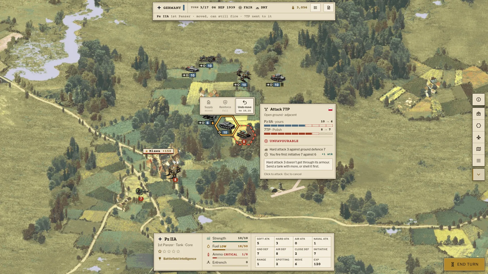

# The new UI: design system

The war room interface for stage D (#130): paper, typed orders and brass, in two themes (Paper
and Blackout), designed on the game's real rules and screens. This folder is the spec the new UI
is built from, and its source of truth.

## Read first

- [principles.md](principles.md): the character, content, color, type, layout, touch, icons and
  motion rules, and **What the map has to show**: every rule the engine knows and where the player
  sees it.
- [PLAN.md](PLAN.md): how the build is split into phases, in what order, and when a piece is done.
- [handoff.md](handoff.md): files, theme switch, element map, performance and accessibility rules.
- [attack-preview.md](attack-preview.md): the UX study behind the attack preview.

## The files

| Path | What it is |
|---|---|
| `tokens.json` | colors per theme, spacing, radius, sizes, z-index and the font families |
| `tokens.css` | the same as custom properties, generated, with the type scale as `--type-<style>-size` and `-line` |
| `src/view/tokens.ts` (the repo's) | the same tokens for the canvas, generated: colours by theme, the map's colours, lengths in pixels, durations in milliseconds |
| `src/view/fonts.css`, `src/view/fonts/` (the repo's) | the three faces, self-hosted woff2 files (latin and latin-ext) under the OFL |
| `src/view/*.css` (the repo's) | the components' CSS, one file per component or family, loaded in the order of `library.css`; colors only through `var(--…)` |
| `components/bundle.css` | the screens' CSS and the mockup frames, loaded after the components', colors only through `var(--…)` |
| `components/bundle.js` | the icon sprite (66 icons and the nation marks) and `PM.mount()`; `src/view/sprite.ts` is its port, kept the same by a test |
| `components/<Name>/preview.html` | the card: an HTML fragment drawn with the files above |
| `components/<Name>/README.md` | what the card does, its rules, states and the ids to keep |
| `renders/<Name>.webp` | the card rendered in Paper, for reading here on GitHub |
| `assets/` | map, sprites and photograph used only to stage the cards (see its README) |
| `index.html` | a viewer for the cards, live, with the theme switch, and under a card the real components (`live.html`, from `src/view/gallery.tsx`) in both themes |

## Viewing and changing

- **On GitHub:** the gallery below links every render and README.
- **Live:** `npm run dev`, then open `/docs/ui/` on the dev server. Pick a card, switch Paper and
  Blackout, open its README.
- **After changing a card:** `node scripts/ui-design.mjs --render <Name>` refreshes its render
  (headless Chrome and `cwebp`). Without arguments it rewrites `tokens.css`, `src/view/tokens.ts`,
  `components.json` and the gallery below. `--check` (a test runs it) fails on a colour or a font
  size written in the CSS instead of its token, on a map colour (`hex-*`, `map-*`) drawn in a card
  without its token, and on generated tokens older than `tokens.json`. Black or white at an alpha
  is shading and may be written in.

## Gallery

Status says whether a card can be built as it is (PLAN.md): Ready, or what has to come first. It is the `status` of the card's `@dsCard` line, next to its group and subtitle; a card that shows something the game doesn't do isn't Ready.

<!-- gallery:start (written by scripts/ui-design.mjs) -->

### Screens · In game

| Card | What it shows | Status |
|---|---|---|
| [AirLayer](components/AirLayer/README.md) [render](renders/AirLayer.webp) | Air layer at 1920×1080: aircraft on top with their markers, ground units alone on a hex whole, those under an aircraft at 75% with a chip, the air target picked | Ready |
| [AttackPreview](components/AttackPreview/README.md) [render](renders/AttackPreview.webp) | The attack preview in four stages, from the target marks to the full breakdown, and the stage 1 cursor in each situation | Stages 0–2 ready; stage 3 needs the hit chance from the core first |
| [CombatLog](components/CombatLog/README.md) [render](renders/CombatLog.webp) | Combat log and turn summary (#combatLog) at 1920×1080 | Ready |
| [CombatOdds](components/CombatOdds/README.md) [render](renders/CombatOdds.webp) | Combat odds v2: overrun, rugged defense, a costly close combat and a safe bombardment, with the reasons and what happens next | Ready |
| [CombatResults](components/CombatResults/README.md) [render](renders/CombatResults.webp) | After the combat: losses over each hex, one stamp for what happened, and the same line in the status bar | Ready |
| [Deployment](components/Deployment/README.md) [render](renders/Deployment.webp) | Deployment at 1920×1080: the zone, units placed, the next one shown on the hovered hex, and the reserve tray | Ready |
| [Equipment](components/Equipment/README.md) [render](renders/Equipment.webp) | Equipment window (#equipment) at 1366×768: class tabs, sorted grid, comparison, transport, prestige | Ready |
| [GameMenu](components/GameMenu/README.md) [render](renders/GameMenu.webp) | Game menu (#menu): the game's own buttons, open and folded, the labelled rail for touch, and every keyboard shortcut | Ready |
| [HudDesktop](components/HudDesktop/README.md) [render](renders/HudDesktop.webp) | The full HUD at 1920×1080 over the Ciechanów map: unit selected, context menu, odds preview | Ready |
| [HudLaptop](components/HudLaptop/README.md) [render](renders/HudLaptop.webp) | The full HUD at 1366×768: the same elements, proving the map stays visible on a small laptop | Ready |
| [MapLayers](components/MapLayers/README.md) [render](renders/MapLayers.webp) | The same hexes in the ground layer and the air layer: which unit is on top, which gets the marker on a shared hex, which is the target | Ready |
| [MapOverlays](components/MapOverlays/README.md) [render](renders/MapOverlays.webp) | The map layer: selection, move area, enemy zones, move path, attack target, support fire, fog, entrenchment, objectives and towns | Ready |
| [MovePath](components/MovePath/README.md) [render](renders/MovePath.webp) | Move path preview (#32): the route to the hovered hex, moves and fuel left, and where a move stops, captures, turns blind or ends firing | Ready |
| [StatusBar](components/StatusBar/README.md) [render](renders/StatusBar.webp) | Status bar (#statusbar): side, turn, date, weather, ground, rules, prestige, turn report and status message | Ready |
| [StrategicMap](components/StrategicMap/README.md) [render](renders/StrategicMap.webp) | Strategic map at 1920×1080: the whole Ciechanow map, units as side chips, objectives as large plaques | Ready |
| [SupplyRules](components/SupplyRules/README.md) [render](renders/SupplyRules.webp) | Where to resupply and reinforce: the divisors the engine applies, with real numbers for one tank | Ready |
| [Tooltips](components/Tooltips/README.md) [render](renders/Tooltips.webp) | Hex tooltip with what the terrain does, unit pins (low fuel, no ammo), button tooltip and the AI status indicator | Ready |
| [TurnBanner](components/TurnBanner/README.md) [render](renders/TurnBanner.webp) | The short turn report (#combatLog) through a scenario: early, late, last turn, Blackout | Ready |
| [TurnStart](components/TurnStart/README.md) [render](renders/TurnStart.webp) | Start of a turn at 1920×1080: the short turn report under the status bar, the first unit selected | Ready |
| [UnitCard](components/UnitCard/README.md) [render](renders/UnitCard.webp) | The full unit sheet: identity, experience, condition in words, every stat with what it is for, leader abilities and the next upgrade | Ready |
| [UnitContext](components/UnitContext/README.md) [render](renders/UnitContext.webp) | Unit context menu (#unit-context): the old menu's icon buttons, docked at the bottom above the unit info, only the actions the unit can take now | Ready |
| [UnitInfo](components/UnitInfo/README.md) [render](renders/UnitInfo.webp) | Unit info panel (#unit-info): identity, supply meters and the full stat sheet | Ready |
| [UnitList](components/UnitList/README.md) [render](renders/UnitList.webp) | Unit list (#container-unitlist) as a strip under the status bar | Ready |
| [ZoomLevels](components/ZoomLevels/README.md) [render](renders/ZoomLevels.webp) | Detail by zoom: what the map shows at the strategic fit, at 1×, and at the 2–3× map scale, and why markers keep their size | Ready |

### Controls

| Card | What it shows | Status |
|---|---|---|
| [Button](components/Button/README.md) [render](renders/Button.webp) | Primary, secondary, icon, ghost and danger, with hot, pressed, disabled and focus states | Ready |
| [ListRow](components/ListRow/README.md) [render](renders/ListRow.webp) | Selectable rows with a group header, as in the campaign and scenario lists | Ready |
| [Meter](components/Meter/README.md) [render](renders/Meter.webp) | Supply meters in ok, low and critical, experience stars and strength badges | Ready |
| [Panel](components/Panel/README.md) [render](renders/Panel.webp) | The HUD panel and the modal window with header and footer | Ready |
| [SegmentedControl](components/SegmentedControl/README.md) [render](renders/SegmentedControl.webp) | Sort, filter and transport choice | Ready |
| [Slider](components/Slider/README.md) [render](renders/Slider.webp) | Interface width, interface scale and map scale | Ready |
| [Tabs](components/Tabs/README.md) [render](renders/Tabs.webp) | Icon tabs with counts, as in the equipment class filter, and text tabs | Ready |
| [Toggle](components/Toggle/README.md) [render](renders/Toggle.webp) | On, off and disabled, as used in the settings window | Ready |

### Screens · Menus

| Card | What it shows | Status |
|---|---|---|
| [CampaignEnd](components/CampaignEnd/README.md) [render](renders/CampaignEnd.webp) | End of campaign at 1920×1080: victory and defeat side by side | Ready |
| [CampaignSelect](components/CampaignSelect/README.md) [render](renders/CampaignSelect.webp) | Campaign selection at 1920×1080: list grouped by side, description, country, difficulty, scenarios, starting prestige | Ready |
| [Dossier](components/Dossier/README.md) [render](renders/Dossier.webp) | End-of-scenario dossier (#dossier) at 1920×1080: outcome stamp and medal, the campaign's outcome text, the units destroyed and lost by class, and the medal record | Ready |
| [MessageDialog](components/MessageDialog/README.md) [render](renders/MessageDialog.webp) | Message dialog (#ui-message) as a scenario briefing over the map at 1366×768 | Ready |
| [NewGame](components/NewGame/README.md) [render](renders/NewGame.webp) | Start menu on a first run: no Continue, the three new-game choices with what each one is, Campaign as the primary action | Ready |
| [SaveLoad](components/SaveLoad/README.md) [render](renders/SaveLoad.webp) | Save and load (#smState) at 1920×1080: file and cloud, the last saves, and the error and empty states | Ready |
| [ScenarioSelect](components/ScenarioSelect/README.md) [render](renders/ScenarioSelect.webp) | Scenario selection at 1920×1080: list, sides and countries, description and turns | Ready |
| [Settings](components/Settings/README.md) [render](renders/Settings.webp) | Settings at 1920×1080: theme switch, interface sliders, the rules new games play, and gameplay toggles | Ready |
| [StartMenu](components/StartMenu/README.md) [render](renders/StartMenu.webp) | Start menu at 1920×1080: wordmark, new game, continue, load, settings, credits, over a slowly panning photograph | Ready |

### Other

| Card | What it shows | Status |
|---|---|---|
| Cover [render](renders/Cover.webp) |  | Not built: the README's banner |

### Foundations

| Card | What it shows | Status |
|---|---|---|
| [Icons](components/Icons/README.md) [render](renders/Icons.webp) | The full stroked icon set and the filled nation marks | Ready |

### Screens · Tablet

| Card | What it shows | Status |
|---|---|---|
| [TabletEquipmentLandscape](components/TabletEquipmentLandscape/README.md) [render](renders/TabletEquipmentLandscape.webp) | iPad landscape: equipment full screen, 3-column grid and the comparison column | Ready |
| [TabletEquipmentPortrait](components/TabletEquipmentPortrait/README.md) [render](renders/TabletEquipmentPortrait.webp) | iPad portrait: equipment full screen, grid on top and the comparison below | Ready |
| [TabletHudLandscape](components/TabletHudLandscape/README.md) [render](renders/TabletHudLandscape.webp) | iPad landscape (1180×820): touch HUD with labelled rail, compact unit info and odds on first tap | Ready |
| [TabletHudPortrait](components/TabletHudPortrait/README.md) [render](renders/TabletHudPortrait.webp) | iPad portrait (820×1180): bottom command bar, two-row status bar, unit card above the bar | Ready |
| [TabletUnitInfo](components/TabletUnitInfo/README.md) [render](renders/TabletUnitInfo.webp) | iPad portrait: the unit sheet opened from Stats, with actions and the full stat sheet | Ready |

<!-- gallery:end -->
