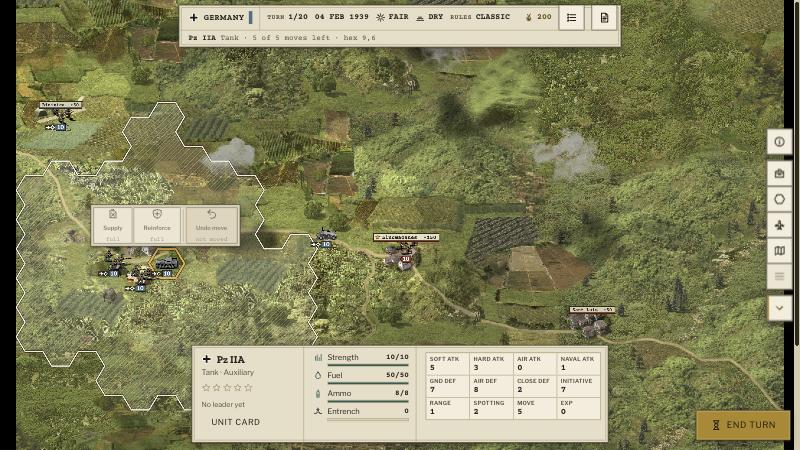
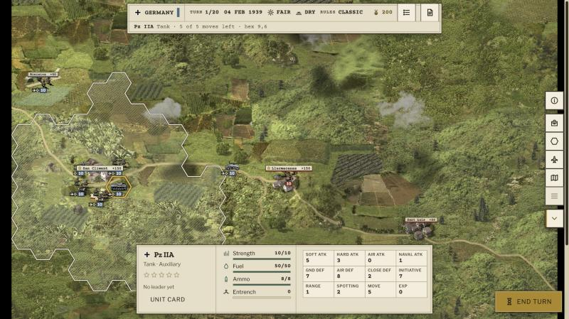
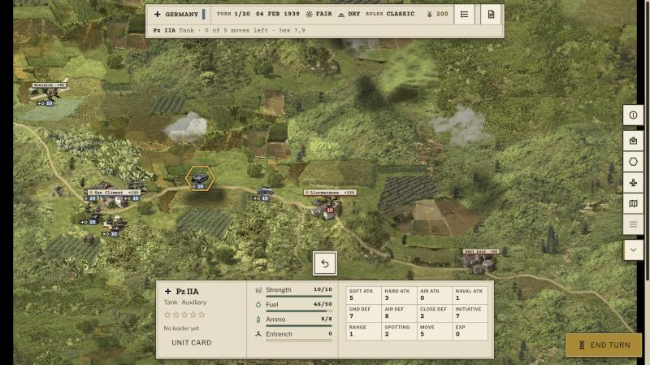
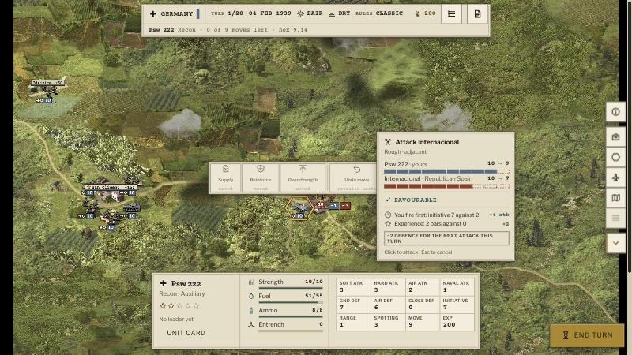
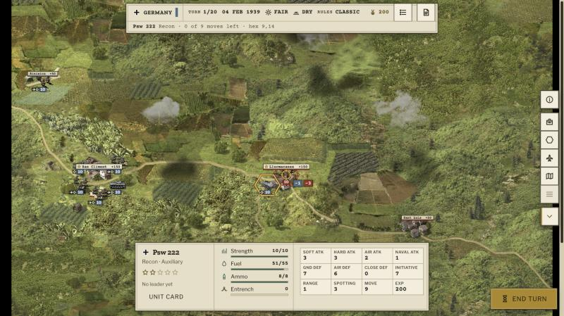

# Screenshots: toning the new UI down to the old UI's functionality

Not for merging. The tutorial (Battle of Minorca) under `?ui=new&theme=paper` at 1366×768, in the dev server's
browser pane (shown at 800 px wide). "Before" is main; "after" is the pull request's branch, the same scene.

## The unit context menu (#437)

Before: the Pz IIA at San Climent selected; its menu covers the hexes above it (a click meant for a move there pressed
a button instead, #429).

After, the same tank selected: a full unit has no action, so no menu.

After, the tank moved: Undo, docked above the unit info.

## Attacking (#441)

Before: the Psw 222 moved next to the Republicans at Llucmacanes, the pointer resting on them: the odds card, the loss
chips and the context menu over the map.

After, the same scene: the crosshair and the two losses, as the old cursor showed them.

